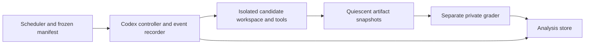

# Codex subscription harness plan

References to `~/Projects/llm-coding-benchmark` identify a separate read-only local checkout, not files distributed with this repository.

Research/design only. No model jobs were launched and no credentials were read or modified for this review. Reference project reads were confined to documentation and source. Installed CLI observed on 2026-10-10: `codex-cli 0.156.0`.

## Verified interfaces and remaining qualification

Official documentation supports scripted `codex exec`, JSONL events, saved authentication and explicit session continuation. ChatGPT sign-in supplies subscription access; API-key sign-in supplies usage-based access. Neither public model documentation nor CLI help proves account-specific model access. Sources: [non-interactive mode](https://learn.chatgpt.com/docs/non-interactive-mode), [authentication](https://learn.chatgpt.com/docs/auth).

Locally inspected `codex exec --help`, `codex exec resume --help` and `codex exec fork --help`. This version advertises `--json`, `-m`, configuration overrides, `--ignore-user-config`, persisted sessions, explicit-ID resume and explicit-ID fork. Help documents interfaces, not faithful state cloning or telemetry correctness. Qualify those with harmless development jobs before scoring. Use the requested model identifiers in [the design](benchmark-design.md); never silently fall back to a different model/effort or an API key.

Candidate command shape for a **disposable, externally isolated runner**, not a command executed by this research task:

```text
codex exec --json --ignore-user-config --strict-config \
  -m gpt-6-astra -c 'model_reasoning_effort="low"' \
  -C /workspace -
```

Supply the chosen write/approval policy through the explicit benchmark configuration after validating the external sandbox. The shape above omits deployment-specific permission flags intentionally; it is not a complete launch script. Use process argument arrays and stdin, not interpolated shell strings. Resolve the actual versioned binary once before a block rather than letting a home wrapper update it on every launch.

For continuations, use `codex exec resume <recorded-session-id>` with JSON output and the same qualified model/configuration. Never `--last`: concurrent or intervening sessions make that ambiguous. Do not use `--ephemeral` when measuring resume/fork. The reference's older integration used ephemeral sessions and fresh-process followups; that loses conversation continuity and changes the nudge experiment.

## Architecture



The grader has no feedback edge to the controller's nudge decision or the candidate. Policy messages depend on terminal state and budget, never hidden success. Private grading can happen after all continuations finish. Public tests are part of the candidate environment only in T1.

Separate model-controller networking from candidate tool networking where the runner supports it. The controller needs authenticated provider access; candidate commands need only pinned local tools and docs. Validate the actual boundary. A container with broad host mounts, sibling results, inherited Docker socket or unrestricted host process access is not isolation.

Implementation alternatives:

1. A trusted Codex process with command execution routed into a tightly scoped worker through a supported remote execution/tool interface, keeping credentials and session storage outside candidate-readable files.
2. A disposable whole-run container with narrowly provisioned auth and independently isolated grader. This is simpler, but credential visibility to candidate shell processes must be explicitly assessed and minimized; “containerized” does not mean “credential inaccessible.”

Choose and test the simplest viable layout during qualification. Do not claim an interface is available until its exact CLI version passes the contract. Private local automation should use the user's supported subscription sign-in path. Never bake credentials into images, task bundles, result archives or public CI, and never copy the whole home configuration. Preserve refresh state through the supported credential lifecycle without changing the user's account identity. Auth setup details remain private; manifests record only `auth_mode: chatgpt` and access/qualification outcomes.

## Benchmark isolation

- Each attempt starts in a new worker with a fresh repository containing only its starter, public specification, allowed local docs and condition-specific public tests.
- No benchmark repo, sibling workspaces, grading source, reference solutions, result reports, hidden seeds, home skills/memory, unrelated MCP servers or old sessions are mounted into candidate tools.
- Keep the necessary current session in controller storage. Forked/resumed runs receive only their own approved history. Avoid a shared model-visible session directory containing earlier answers.
- Pin all dependencies in the image. Candidate tool networking is disabled; provider communication is separately allowlisted. Installation is outside measured work, while task-specific builds/compilation remain inside.
- Protect build/check policies, launcher and public suite outside writable submission paths; grade source with trusted copies. Reject path escapes, symlinks into protected paths, shell-outs to alternate language solutions and altered required compiler settings.
- Execute grading in a fresh sandbox too: candidate code is still untrusted when imported by a trusted evaluator. Never run submitted scripts with access to evaluator secrets, credentials or host paths.
- Fix CPU allocation, RAM, process count, disk budget and concurrent worker count; record actual resource kills. Serialize runtime performance grading or use isolated reserved cores and randomized reference/candidate order.

The reference project's CLAUDE.md describes both sibling-answer copying and grading-key reads, including leakage through parent Git history. Hiding files in a nearby directory is not a security boundary. Use mount/process/network separation and a fresh Git root; test deliberate `git show`, parent traversal, `/proc`, symlink and network attempts before qualification passes.

## Event capture and normalized records

Write append-only JSONL with controller timestamps, invocation ID and raw payload. Store stderr and exit status separately. Drain both streams concurrently so a full pipe cannot deadlock the run. Terminal-turn detection and process exit are distinct; reap only the process group owned by that invocation, with recorded graceful/forced termination. Never kill unrelated Codex sessions using a global process-name match.

Maintain an explicit state machine:

```text
queued -> environment_ready -> running
running -> terminal_handoff -> snapshot -> nudge_1 -> running
running -> terminal_handoff -> snapshot -> nudge_2 -> running
running -> terminal_handoff | budget_exhausted | infrastructure_error
final snapshot -> isolated_grading -> normalized_result
```

The controller tracks nudge count to prevent cycling beyond two. Early terminal successes are still eligible for the fixed messages because success is unknown to the controller. Long silent reasoning or an active compile is not a handoff. A watchdog may mark suspected hangs, but should enforce the frozen wall/process deadline rather than deliver unscheduled hints. Quota failures halt the queue and retain the incident; no evasive retries or credential switching.

Proposed run manifest fields:

```json
{
  "schema_version": 1,
  "run_id": "unique-attempt-id",
  "task": {"family": "F1", "instance": "private-instance-id", "contract_sha256": "hash"},
  "language": {"name": "rust", "toolchain_digest": "digest", "config_sha256": "hash"},
  "model": {"requested": "gpt-6-astra", "resolved": null, "effort": "low"},
  "agent": {"cli_version": "0.156.0", "config_sha256": "hash", "auth_mode": "chatgpt"},
  "condition": {"track": "A", "tests": "T0", "assistance": "two_fixed_nudges"},
  "replicate": 1,
  "block_id": "randomized-day-block",
  "budget": {"base_seconds": 7200, "continuation_seconds_each": 1800, "max_nudges": 2},
  "initial_artifact_sha256": "hash",
  "environment_digest": "digest",
  "hidden_manifest_commitment": "hash"
}
```

Null resolved model means unverified, not presumed equal. Add resource limits, full effective tool inventory, context/compaction settings, starter/public-suite hashes and allowed submission paths to the implemented schema. Keep hidden values themselves in private scheduler storage. Qualify whether the provider exposes a resolved snapshot; if not, record requested alias, lack of visibility and collection date instead of inventing an immutable snapshot.

Proposed result fields include validity and reason; all invocation/thread/parent IDs; raw usage plus semantic version/completeness; monotonic intervals; check/process events; mutation snapshots; unattended/each-nudge/final artifact hashes; intervention text hashes; grader version and requirement-group outcomes; resource exhaustion; source/diagnostic sizes; and public/hidden score separation. Large traces remain artifacts referenced by hashes.

## Reuse and changes from the reference harness

| Read-only reference | Useful part | Required change here |
|---|---|---|
| runner.py (reference checkout: `~/Projects/llm-coding-benchmark/scripts/benchmark/runner.py`), `build_codex_command`, `extract_codex_metrics`, `stream_process_output` | JSON event parsing, thread capture, timestamps/process handling, absolute paths | Persist and resume sessions; independently qualify token scope and reasoning overlap; partial-failure telemetry; fixture tests for duplicates |
| Codex integration notes (reference checkout: `~/Projects/llm-coding-benchmark/docs/codex-integration.md`) | Documents stdin, path and shell-wrapper pitfalls | Historical API-key/ephemeral notes are not the new subscription design |
| frontier_native.py (reference checkout: `~/Projects/llm-coding-benchmark/scripts/frontier_native.py`) | Existing subscription-mode checks and environment boundary probes | Avoid hardcoded credential-storage assumptions; deepen isolation checks; keep secrets outside archived output |
| v4.1 frontier runner (reference checkout: `~/Projects/llm-coding-benchmark/scripts/run_v41_frontier.py`) and tests (reference checkout: `~/Projects/llm-coding-benchmark/scripts/test_v41_frontier.py`) | Entry points for implementation follow-up | Review fully before adapting; not claimed audited by this research pass |
| v5 design (reference checkout: `~/Projects/llm-coding-benchmark/benchmark-v5/DESIGN.md`) | Paired assistance controls, independent grading, budgets and failure taxonomy | Main nudge dispatch independent of private grades; add language/checker/test factorials |

The reference adapter includes a specific note about a secret-redaction mechanism corrupting ordinary output digits. Add a redaction fidelity fixture: nonsecret literals, hashes and score values must survive unchanged. Redact known secret values and structured secret fields, not generic numeric flags. This plan changes nothing in the reference repository.

## Qualification checklist before scored jobs

1. Build and run every language starter and correct reference offline under exact resource limits; verify the no-test and test conditions expose only intended differences.
2. Authenticate through supported subscription access, confirm each requested model/effort is accepted, detect fallback and record any snapshot visibility limits.
3. Run a harmless file edit, successful check, failed check and recovery. Verify UTF-8, stdout/stderr, truncation, process exits and timeout cleanup.
4. Resume an explicit session; prove conversation continuity and model/effort preservation. Fork it twice into independent workspaces; verify initial histories/artifacts match and later writes do not cross over.
5. Verify token accumulation over multiple turns, resumes and replayed events; test missing fields, crashes before final usage, cached input and reasoning accounting.
6. Prove hidden tests, references, sibling results, host credentials and unrelated session histories are inaccessible through the chosen boundaries. Record any remaining auth/tool boundary limitation and fix it before running untrusted tasks.
7. Run known-good and deliberately broken submissions through each grader; verify critical failure gates, liveness checks and indeterminate evaluator outcomes.
8. Check snapshot atomicity, manifest/hash completeness, quota backoff and restart behavior. Repeat of a completed run must create a new attempt in a clean workspace, never polish the old artifact.

Implement parser and controller tests with recorded/synthetic event fixtures before spending subscription quota on a full matrix. Research documentation is complete without those tests; they are implementation acceptance requirements.
